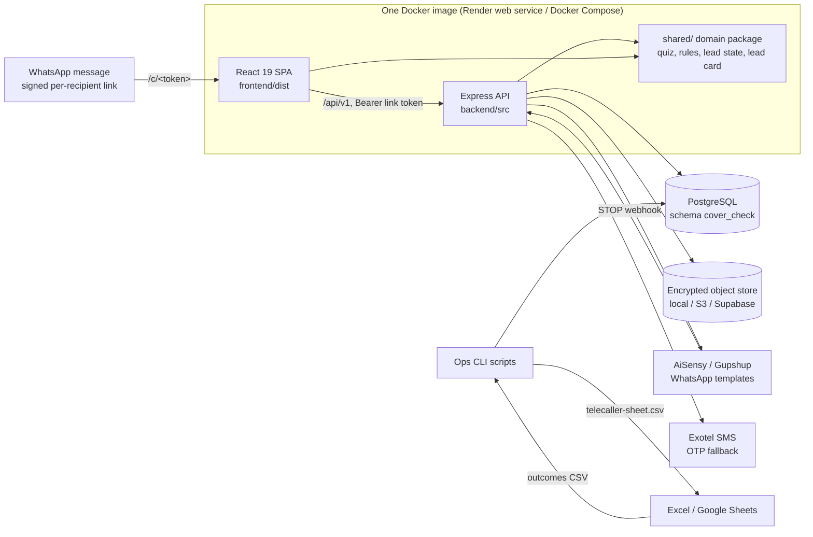
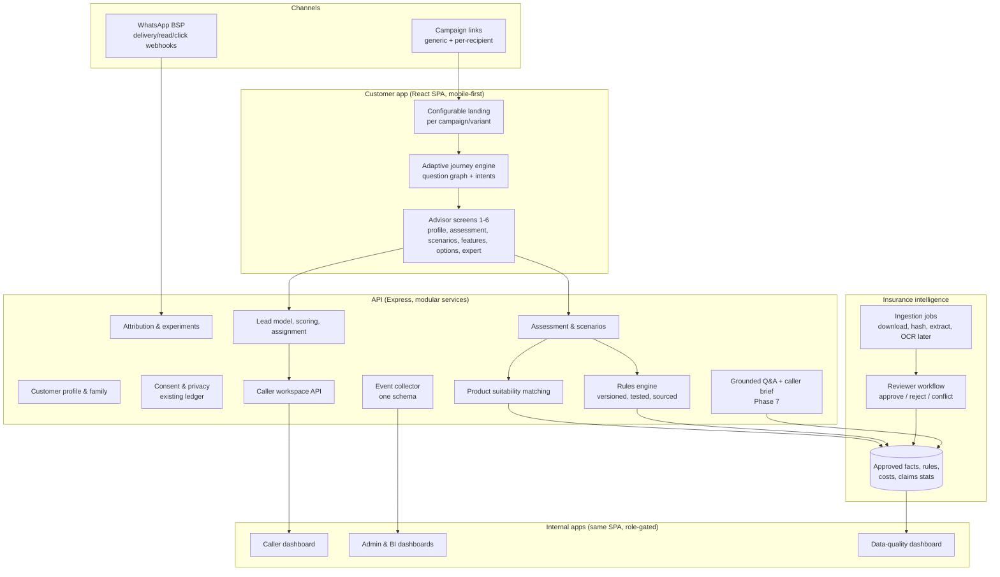

# Current Architecture and Proposed Target Architecture

Part A describes the system as it is (verified against code on 16 Nov 2026). Part B proposes the target, changing as little as possible. Part C maps the WhatsApp-to-policy-issuance funnel and shows which stages can be measured today.

---

## Part A — Current architecture

### A1. Runtime view

### A2. Code layout

| Layer | Path | Responsibility |
|---|---|---|
| Domain | `shared/src` | Enums; quiz definition and validation (`quiz.ts`); readout rules R1–R8 (`readout.ts`); advice and plan boards (`advice.ts`, `planBoard.ts`, `policyBoard.ts`, `insights.ts`, `persona.ts`); plan catalogue and approval gate (`planCatalog.ts`); benchmarks with sources (`benchmarks.ts`); lead state, priority, SLA and calling slots (`handoff.ts`); lead card (`leadCard.ts`); WhatsApp summary builder |
| API | `backend/src/http` | Routes (thin), Zod schemas, link-token and agent-key middleware, error mapping |
| Services | `backend/src/services` | journey, OTP, hand-off, document, value (recommendations, checklist, summary), telecaller sheet, link token, lead state, retention (uncommitted) |
| Data access | `backend/src/repositories` | All SQL, one repository per record type |
| Integrations | `backend/src/integrations` | WhatsApp (AiSensy, Gupshup, console), Exotel SMS, encrypted storage, policy extractor (demo / manual / pdf-text), product document reader |
| Scripts | `backend/src/scripts` | issue link, batch links from an audience CSV, export leads, import outcomes, ingest insurer product PDF |
| UI | `frontend/src` | One screen at a time (`App.tsx`), flow reducer (`state/flow.tsx`), HTTP and mock API clients, screens, design tokens, inline SVG illustrations |
| Schema | `data/migrations` | 001 core (11 record types, enums, consent ledger) · 002 views, retention function, roles · 003 export tracking · 004 value layer · 005 v3 quiz · 006 v4 one-screen · 007 scoped purge · 008 product intelligence |

### A3. Data model (as built)

| Group | Tables / views |
|---|---|
| Acquisition | `source` (one row per link open: token hash, door, campaign_id, creative_id, wa_template_id, utm source/medium/campaign, device) |
| Customer journey | `lead` (one per mobile), `quiz_session`, `quiz_answer` (typed columns), `quiz_answer_meta` (time per screen), `consent` (append-only), `consent_current` (view), `notice_version`, `otp_challenge`, `pincode_directory` |
| Value layer | `finding` (rules shown), `readout_rule`, `recommendation` (plan types shown/clicked), `checklist_mark`, `whatsapp_message` (with body hash) |
| Documents | `policy_document` (encrypted file ref, retention_until), `policy_fact` (value, page, confidence, user value), `document_access_log`, `policy_profile` (view) |
| Hand-off | `handoff` (requested action, slot, consent ref, priority, queue, SLA, export batch), `call_outcome` (disposition, enquiry id, quote_shared, policy_sold), `agent_queue` (view), `lead_card_source` (view) |
| Analytics | `event` (name CHECK-constrained), views `funnel_daily`, `screen_dropoff`, `quiz_timing`, `card_dropoff`, `dropoff_by_version`, `recommendation_funnel` |
| Product intelligence | `insurer_product`, `product_source_document`, `product_fact_evidence`, `approved_product_facts` (view) |
| Roles | `cover_check_app`, `cover_check_agent`, `cover_check_bi`: defined, NOLOGIN, **not used by the app** |

### A4. Key flows

- **Link open:** verify the HMAC token → advisory lock on the token hash → reuse the lead bound to that token, or upsert by mobile → insert a `source` row → log `link_clicked` → return bootstrap (door, masked mobile, open session answers, call slots).
- **Quiz:** first tap grants `save_answers` consent and starts a session → each save is re-validated with the shared definition → complete records which rule lines were shown (`finding`).
- **Call request:** contact-consent tick + verified OTP + slot inside 9–21 IST → `handoff` row → `recomputeLeadState` → enqueue with priority/SLA only if consent is live and not DND.
- **Telecaller:** `agent_queue` → CSV (each hand-off exported once) → callers fill disposition → import writes `call_outcome`; `do_not_call` withdraws consent.
- **Upload:** `read_document` consent → OTP → encrypt and store → extract (manual in production) → customer confirms → policy board → plan types.

### A5. Deployment

- **Image:** `Dockerfile` runs `npm test -w shared`, `npm test -w backend` and the backend typecheck, then builds the frontend and serves the SPA from Express (`WEB_DIST`). The backend tests need PostgreSQL, which a plain `docker build` doesn't have (audit B7).
- **Render:** `render.yaml`, one Docker web service (starter plan), `/readyz` health check, Supabase Storage for documents.
- **Self-host:** `deploy/docker-compose.yml` with Postgres, Caddy (automatic HTTPS), nightly `pg_dump` to a local volume.
- **Not present:** CI pipeline, staging environment, structured logging, error monitoring, alerting, restore test.

---

## Part B — Proposed target architecture

**Principles:** keep the stack (TypeScript, Express, PostgreSQL, React). It is sound and well tested, and a rewrite to Next.js/FastAPI would cost months without improving the business outcome. Add modules rather than rebuild. Keep deterministic rules as the source of truth and add AI only as an explanation layer on top of verified data.

### B1. Module map

### B2. Main changes from today

| Area | Today | Target | Reason |
|---|---|---|---|
| Campaigns | Free-text `campaign_id` inside a per-recipient token | `campaigns`, `campaign_links`, `campaign_variants` tables; both generic links (`/h/<slug>?utm_*`) and per-recipient signed links; landing copy pulled from campaign config | The brief needs measurement per campaign and creative, and reusable links for non-WhatsApp channels. |
| Identity and session | 14-day bearer token in URL | Token → short-lived HttpOnly session cookie; generic links create an anonymous session that becomes a lead when the customer gives a mobile with OTP | Closes S3; supports anonymous campaign traffic. |
| Journey | One fixed screen, 3 situations | Question graph (`journey_definition` JSON, versioned) with 11 intents and conditional branches; the same shared validator on client and server | Adaptive journey (Stage B–G of the brief). |
| Rules | 3 overlapping layers | One `rules/` module: each rule has id, version, inputs, output, source citation, owner, tests; evaluated server-side; results stored with rule version | Explainability (FACT / RULE / ASSUMPTION labels) and auditability. |
| Products | Empty catalogue + evidence snippets | Product → variant → document → approved fact, with effective dates; matching only uses `approved_product_facts` | "No source, no factual claim." |
| Events | Two vocabularies, silent drops | One `event` contract in `shared/` (name, schema, version); collector returns 202 and logs rejects; server-authoritative milestones; client sends only UI-interaction events | Fixes B3/B4; makes drop-off analytics reliable. |
| Leads | lead + handoff + CSV | `leads` (one per person per intent window), `lead_scores` (versioned), `lead_assignments`, `contact_attempts`, `follow_up_tasks`, `quotes`, `proposals`, `payments`, `policy_issuance_records` (source-verified) | Full funnel to issuance (brief §9). |
| Agent access | Shared key | Turtlemint SSO (OIDC) + roles: `caller`, `team_lead`, `admin`, `analyst`, `reviewer`, `privacy_officer` | S4, S5, least privilege for medical data. |
| Sensitive data | Same tables | `medical_disclosures` and `financial_preferences` in a separate schema with column-level grants; analytics only through aggregate views with minimum group size | Brief §13 and §15. |
| AI | None | Phase 7 only: grounded explanations and caller briefs from stored inputs plus approved facts, behind an approved provider config; never generates terms, premiums or eligibility | Brief §14. |
| Ops | No CI, no monitoring | GitHub Actions (typecheck, tests with a Postgres service, build, audit), staging environment, structured JSON logs, error tracking, uptime alert, restore drill | Production readiness. |

### B3. Stack decisions

| Decision | Choice | Alternatives considered |
|---|---|---|
| Backend | Keep Express + TypeScript | FastAPI (the brief suggests it): a rewrite with no user benefit; Python stays for data/ingestion jobs only if it is needed later (OCR, pandas). |
| Frontend | Keep React + Vite SPA; add role-gated internal routes | Next.js: adds SSR complexity; landing speed is already fine on a small SPA. Revisit if SEO landing pages are needed. |
| Database | PostgreSQL; add `pg_trgm`/full-text first, `pgvector` only in Phase 7 | Separate vector DB: unnecessary at this scale. |
| Storage | Supabase Storage (encrypted at app layer) for the pilot; S3 + KMS when Turtlemint IT provisions AWS | Already implemented in both adapters. |
| Jobs | DB-backed job table + worker loop in the same image (retention already works this way) | Queue service: not needed yet. |

---

## Part C — WhatsApp-to-policy-issuance funnel map

Legend: ✅ measurable today · ⚠️ partly or unreliably · ❌ not captured

| # | Stage | Today | Event / record that measures it | Gap |
|---|---|---|---|---|
| 1 | Messages sent | ❌ | none | Need BSP send log (campaign-level) |
| 2 | Delivered / read | ❌ | `whatsapp_message.status` exists, never updated | BSP status webhooks |
| 3 | Link click | ⚠️ | `source` row + `link_clicked` on API open | Counts opens that reach the API, not clicks; use a redirect endpoint for true clicks |
| 4 | Unique visitors | ✅ | distinct `lead_id` on `link_clicked` | Only for per-recipient links; generic links need anonymous visitor ids |
| 5 | Landing viewed | ✅ | `landing_viewed` | — |
| 6 | Journey start | ✅ | `quiz_started` (+ `save_answers` consent) | — |
| 7 | Question-level progress | ⚠️ | `card_answered`, `answer_submitted`, `quiz_answer_meta` | v4 has one screen; per-question events exist but engagement events are dropped (B3) |
| 8 | Journey complete | ✅ | `quiz_completed` | — |
| 9 | Contact details submitted | ✅ | `capture_submitted` | — |
| 10 | Consent captured | ✅ | `consent` rows by purpose | — |
| 11 | Qualified lead | ⚠️ | `lead.lead_state` + `priority` | State is not scored or versioned; no "qualified" definition agreed |
| 12 | Caller assignment | ❌ | `handoff.assigned_agent_id` column and a repository `assign()` method exist, but no code path calls it | Assignment module |
| 13 | First contact attempt | ⚠️ | `call_outcome.attempted_ts` via CSV import | Depends on callers filling the sheet; lag |
| 14 | Connected | ⚠️ | `call_outcome.connected` | Same |
| 15 | Quote generated | ❌ | `quote_shared` column, not in the CSV import | Quote record + source |
| 16 | Proposal started | ❌ | — | Proposal record (from Turtlemint systems) |
| 17 | Payment completed | ❌ | — | Payment record (from Turtlemint systems) |
| 18 | Policy issued | ❌ | `policy_sold` boolean, not imported, not verified | Issuance record matched to policy number from an authorised source (the brief: a sale isn't complete until issuance is verified) |

**Conclusion:** stages 5–10 are measured well. The two ends are missing: delivery and click data before the landing page, and everything after the first call. Milestone 1 of the roadmap closes stages 3, 7, 11 and 12. Stages 15–18 depend on access to Turtlemint's quote/proposal/policy systems, which is a business decision (see `IMPLEMENTATION_ROADMAP.md`, decisions D4–D5).
