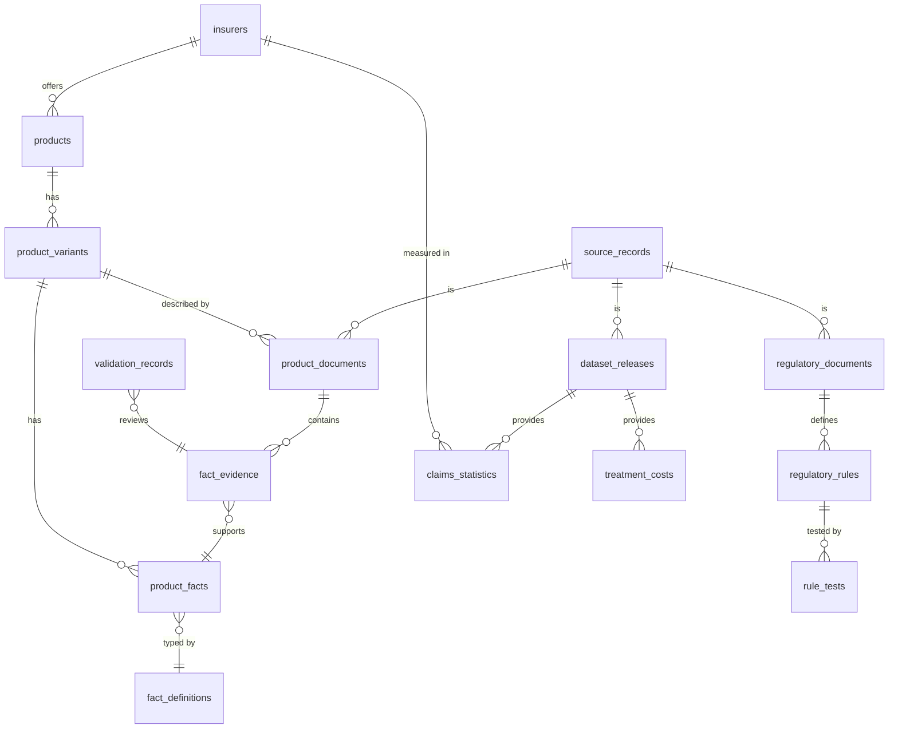

# Data Gap Analysis

What insurance and customer intelligence the product needs, what the codebase holds today, and how to close the gap without inventing data. The structured intelligence database design (brief step 15) is in §4. The first 20 official sources and their verification status are in `DATA_SOURCE_REGISTER.md`.

---

## 1. Summary

| Data domain | Needed for | Held today | Gap size |
|---|---|---|---|
| Insurer product terms (variant-specific) | Suitability matching, "what to look for", options screen | 0 approved products. Ingestion pipeline (migration 008) stores pending-review evidence snippets for 5 allow-listed insurers. | **Very large** |
| Premiums | Options screen, affordability | None (correctly blocked) | **Total**: needs a quote source |
| Regulatory rules (waiting periods, moratorium, portability, PED, age limits, grace period) | Rules engine, explanations | 3 figures in `benchmarks.ts` (PED max 36 months, moratorium 5 years, IRDAI portability page) | Large |
| Claims statistics (insurer-level) | Context only, never a product ranking | 2 figures (average claim, cashless share) | Medium |
| Healthcare costs by city/tier/treatment | Sum-insured scenarios | None; formula uses a flat "+₹5 L for metro" | **Large** |
| Population / market statistics | Context ("how you compare") | 8 figures, some marked VERIFY | Small |
| Customer intelligence (why people buy, delay, distrust; what they misunderstand) | Journey design, copy, scoring | None, beyond persona assumptions | Large, needs original research |
| First-party Turtlemint data (average SI bought, conversion by segment) | Benchmarks, scoring calibration | `FIRST_PARTY` slots are null | Needs internal data access (decision D6) |

## 2. What exists and its quality

| Item | File | Quality |
|---|---|---|
| `SOURCES` (8) + `BENCHMARKS` | `shared/src/benchmarks.ts` | Good practice: every figure shown with its source. Issues: Milliman is a consultancy, acceptable but label it as such; `irdai_mc_2024` points to the department page, not the circular; 58.06 crore lives matches one secondary report while another says 58.20 crore, so confirm against the primary table; `turtlemint` and `cover_rule` are not external sources and shouldn't share the same label style. |
| Plan type catalogue | `shared/src/planCatalog.ts` | General statements about plan types, fine as education. "No upper age limit since 2024" needs a citation. Page URLs "checked Oct 2026" need a link checker. |
| Approved-pick gate | `getApprovedTurtlemintPick` | Good: source URL, ≤ 90 days, approval reference required. |
| Product evidence schema | `data/migrations/008_product_intelligence.sql` | Good foundation: document hash, page, evidence text, approval CHECK. Missing: variant level, effective dates on facts, conflicts between documents, superseding, reviewer UI. |
| Customer upload facts | `policy_fact` | Good: value, page, confidence, customer value kept side by side. Missing: evidence span text, provenance status (extracted / customer-entered / advisor-reviewed / insurer-verified). |
| Fabricated demo products | `shared/src/productDatabase.ts.backup` (tracked) | **Remove.** Named insurers with made-up premiums and ratios. |
| Demo pincode prefixes | `PINCODE_PREFIX_DEMO` | Replace with the official India Post pincode directory (data.gov.in). |

## 3. Source lifecycle: current vs required

The brief requires 11 statuses on every source and extracted record. Migration 008 has:

| Brief status | `product_source_document.ingestion_status` | `product_fact_evidence.review_status` |
|---|---|---|
| DISCOVERED | — (add) | — |
| DOWNLOAD_PENDING | — (add) | — |
| DOWNLOADED | `downloaded` | — |
| EXTRACTION_PENDING | — (add) | — |
| EXTRACTED | `extracted` | — |
| VALIDATION_PENDING | `pending_review` | `pending_review` |
| VERIFIED | — (add: reviewer confirmed text matches source) | — (add) |
| APPROVED | `approved` | `approved` |
| REJECTED | `failed` (≠ rejected) | `rejected` |
| SUPERSEDED | `superseded` | `superseded` |
| ACCESS_RESTRICTED | — (add) | — |
| (extra) conflict | — | `conflict` (keep) |

Required per-record fields that are missing today: publication date on facts (only on documents), last-checked date, reviewer on documents, extraction method version on facts (present), source section/clause reference.

## 4. Proposed structured intelligence database (brief step 15)

Extends migration 008 rather than replacing it. All tables carry `created_ts`, `updated_ts`, a `status` from the lifecycle above, and a `source_record_id` foreign key ("no source, no factual claim").

| Table | Key columns | Notes |
|---|---|---|
| `source_records` | url, publisher, title, doc_type, publication_date, effective_from/to, version, fetched_ts, sha256, licence/terms note, last_checked_ts, status | One row per fetched artefact. |
| `insurers` | name, IRDAI registration no., type (SAHI / general / PSU), website domains (allow-list) | Replaces the hardcoded domain list in `productDocumentReader`. |
| `products`, `product_variants` | product name, UIN, variant name, launch/withdrawal dates | **Variant is the unit of truth.** Never merge similar names. |
| `fact_definitions` | key (e.g. `room_rent_limit`), value schema (JSON Schema), unit, plain-language label, explanation template | About 40 keys, covering the brief's §5 list. |
| `product_facts` | variant_id, fact_key, normalized_value (validated against the definition), effective_from/to, status, approval_reference | Only `approved` facts are readable by the matcher. |
| `fact_evidence` | document_id, page, clause ref, exact text, sha256, extraction method/version, confidence | Many evidence rows can support one fact; disagreement sets the fact to `conflict`. |
| `regulatory_documents`, `regulatory_rules` | circular ref, date, supersedes/superseded_by; rule id, version, expression, plain text, owner, tests | e.g. "PED waiting ≤ 36 months" with circular, clause and date. Old circulars stay but are marked superseded. |
| `claims_statistics` | insurer_id, fiscal year, metric (received / paid count / paid amount / repudiated / pending / ICR / grievances), value, unit, dataset_release_id | Insurer-level only; UI never ranks on one metric. |
| `treatment_costs` | procedure (code + name), geography (tier / state / city), cost_type (`govt_package_rate` / `cghs_rate` / `private_tariff` / `household_oope`), amount, year, dataset_release_id | Cost types are never mixed in one comparison. |
| `hospitals`, `hospital_networks` | hospital id, PIN, accreditation; insurer network membership with as-of date | Phase P2; network lists change often. |
| `premiums` | variant, age band, members, SI, city zone, premium, quote_source, quoted_ts, valid_until | **Only from an authorised quote source.** No extrapolation. |
| `validation_records` | target table/id, reviewer, decision, note, ts | The audit trail behind every approval. |

## 5. Healthcare cost intelligence

Sources and how each may be used (none are interchangeable):

| Source | What it gives | Allowed use |
|---|---|---|
| NSS 80th round, Household Social Consumption: Health (Jan–Dec 2025; report released 2026; unit data on microdata.gov.in) | Hospitalisation out-of-pocket spend, insurance coverage, by state/sector | "Typical household spend" context; state/urban-rural splits |
| National Health Accounts estimates 2022-23 (NHSRC) | National health spending, out-of-pocket share | Macro context only |
| CGHS revised package rates (OM 3 Oct 2025, effective 13 Oct 2025; tiered by city, accreditation, ward) | Procedure-level government reimbursement rates by city tier | Lower-bound benchmark for a procedure, labelled "government reimbursement rate" |
| PM-JAY HBP 2.2 (Nov 2021) and later NHA revisions | Package rates for ~1,670+ procedures | Lower-bound benchmark; labelled as a government package rate |
| Public private-hospital tariffs | Room/procedure tariffs | Only where publicly published; store hospital, date and URL |
| Turtlemint / partner claims data | Actual claim sizes by treatment and city | Best source for scenarios **if** access and privacy review are approved (decision D6) |

**Implication for sum-insured scenarios:** with today's public data, the honest method is: (a) a small set of common high-cost treatments, (b) government rates as a floor, (c) a labelled private-hospital multiplier only if backed by a source (otherwise "unknown"), (d) medical inflation from a cited source, (e) existing usable cover subtracted, with corporate cover counted only while employed. Until advisory/actuarial approve that method, the product should show *ranges with stated assumptions*, not a single "you need ₹X".

## 6. Customer intelligence

Public data does not link income, conditions, existing policies, claims and purchase behaviour at person level, and none of it must be fabricated. Approach:

| Question | Source |
|---|---|
| How common is insurance by type, state, income quintile; out-of-pocket burden | NSS 80th round unit data (aggregate analysis only) |
| Health insurance enrolment by household (and state-level patterns) | NFHS-5 (NFHS-6 when released) |
| Channel mix (group / retail / government), claims, grievances | IRDAI Annual Report 2024-25, Handbook on Indian Insurance Statistics |
| Why people buy, delay, distrust, rely on corporate cover; what they misunderstand | **Original research** (below) |
| What advisors need to know, why leads stall | Structured caller feedback (outcome codes + notes taxonomy) |

**Original, consent-based research programme (draft):**
1. **Customer intercept survey** inside the journey (optional, after value is shown, ≤ 5 questions, separate consent, stored apart from the lead): main reason for looking, biggest worry, what would make them buy, trust in insurers (1–5), understanding check on 3 terms (room rent, waiting period, co-pay).
2. **Advisor survey** (Turtlemint callers, quarterly): top objections, top misunderstandings, which segments convert, what information was missing at the start of a call.
3. **Lost-lead follow-up** (consented, 30 days after a non-conversion): why not, bought elsewhere?
4. Data labelling in storage: every record tagged `observed_fact`, `published_aggregate`, `customer_reported`, `advisor_reported`, `assumption` or `hypothesis` (the brief §6 categories).

## 7. Data quality controls to add

- Link checker for every URL in `SOURCES`, `PLAN_PAGES` and `source_records` (weekly; marks `ACCESS_RESTRICTED` or broken).
- Freshness: facts older than their source's review cycle flip to "needs re-verification" (the approved-pick gate already does this at 90 days).
- Conflict detection: two approved evidence rows with different normalized values → fact status `conflict`, removed from the matcher.
- Data-quality dashboard (brief §11G): counts by lifecycle status, extraction failures, missing fact keys per variant, conflicts, superseded records, rejected events.
