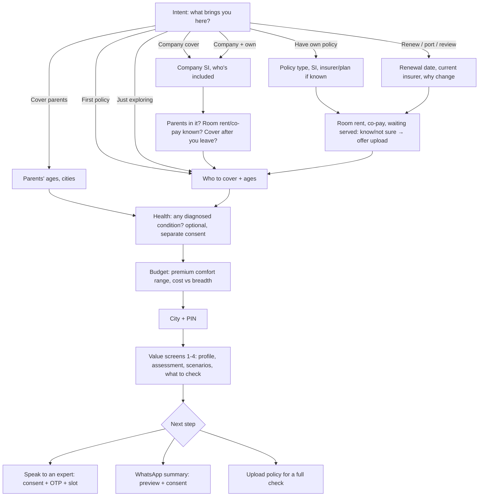

# Product Gap Analysis

Compares the master build brief with what the code does today (verified 16 Nov 2026). Priority: **P0** = needed for the first milestone (working journey + reliable tracking + lead capture), **P1** = next, **P2** = later.

Sections 5–7 hold the proposed designs the brief asks for in its first execution steps (adaptive questionnaire, attribution and event tracking, lead scoring and caller hand-off).

---

## 1. Customer journey (brief §4)

| Requirement | Today | Gap | Priority |
|---|---|---|---|
| Configurable campaign landing, one primary action, fast on mobile | 4 hardcoded "doors" with i18n headlines; small SPA | Landing copy and variant come from code, not campaign config | P0 |
| Preserve attribution, resume an incomplete journey | Token in URL; open session restored on bootstrap | Works for per-recipient links only | P0 |
| 11 distinct intents (first-time, individual, floater, corporate, corporate + personal, add cover, parents, port, renew, review, exploring) | 3 situations: none / own / company (± own policy) | 8 intents missing; no branching after the first answer | P0 (first 6), P1 (port, renew, review) |
| Basic profile: age, city, PIN, occupation, employment type, marital status, income range, dependents | age band, metro/other, income band, adults/children/parents counts; name and PIN at capture | Occupation, employment type, per-member ages missing; city is a 2-way choice | P0 (per-member age bands), P1 (occupation, employment) |
| Existing-cover details (insurer, product, floater/individual, SI, members, dates, room rent, co-pay, deductible, sublimits, restoration, NCB) | Only an SI band in the quiz; full facts only through upload + manual entry | No structured manual entry in the quiz path; no "not sure" handling per field | P1 |
| Policy document upload with extraction, confirmation, uncertainty flags | Built (U1–U7), manual extractor in production, `pdf-text` blocked | OCR, evidence spans, multi-file handling (only first file used) | P1/P2 |
| Corporate cover assessment (SI, dependents, parents, portability on exit, room rent, co-pay, personal policy) | `company` + "also own policy?" + SI band | Dependents/parents-in-group, room rent, co-pay, exit continuity not asked in v4 (fields exist from v3) | P0 |
| Family and dependents with per-member age and eligibility | Counts only; parents assumed 60+ (B5) | Per-member age band; separate-vs-floater reasoning backed by product eligibility | P0 |
| Medical profile with consent, no diagnosis, no inference | `health_condition` and `condition_tags` exist in schema, not asked in v4 | Needs a separate sensitive-data consent, restricted storage, plain explanation of why disclosure matters | P1 |
| Affordability (premium comfort range, frequency, cost vs breadth preference) | Income band only, and it is used to raise "need" | Ask premium comfort directly; stop using income to size need | P0 |
| Healthcare geography (PIN, local costs, hospitals) | Metro/other; demo pincode prefix table | Real PIN → city/tier directory; cost benchmarks by tier | P1 |

## 2. Advisor experience (brief §8)

| Screen | Today | Gap | Priority |
|---|---|---|---|
| 1 Your insurance profile | Profile line on the plan board | Needs a full summary with "you told us" labels | P0 |
| 2 Coverage assessment | "Need vs have" bar | Must show assumptions and label each figure (FACT / CUSTOMER INPUT / RULE / ASSUMPTION) | P0 |
| 3 Coverage scenarios (Essential / Balanced / Higher) | One suggested figure | Three ranges, each with reasons, assumptions and limitations | P1 (needs advisory-approved method) |
| 4 What to look for in a policy | Checklist + plan "points" + policy-board explainers | Make it situation-driven and source-cited | P1 |
| 5 Relevant insurance options (verified only, no fabricated premiums) | Plan *types* only; named products blocked until approved | Needs approved product facts and a quote source | P2 (depends on data) |
| 6 Speak to an expert (what is shared, explicit consent, early call allowed) | Built: slot, language, consent tick, OTP | Show exactly what the caller will see before consent | P0 |

## 3. Lead generation and conversion (brief §9)

| Requirement | Today | Gap | Priority |
|---|---|---|---|
| Structured lead record with campaign, variant, intent, family, cover status, budget, concerns, progress, consent, preferred time, status, assignee, conversion | Spread over `lead`, `source`, `quiz_answer`, `handoff`, `call_outcome` | No intent, concerns, budget, variant or conversion status; one lead per mobile forever | P0 |
| Transparent qualification model; readiness separate from suitability; distinct categories | 4 lead states + P1–P4 | Not scored, not versioned; categories don't match the brief (e.g. "needs specialist review") | P0 |
| Caller assignment (availability, capacity, expertise, language, workload, manual reassign, escalation) | None: `handoffRepository.assign()` exists but nothing calls it | Whole module | P1 |
| Caller dashboard, "understand the customer in under a minute" | Lead card (good content) shown only in prototype and CSV | In-app dashboard with roles | P1 |
| Grounded AI conversation brief | `openingScript` template | Template is fine for now; AI brief in Phase 7 | P2 |
| Structured outcomes (16 statuses) + follow-up scheduling and history | 5 dispositions; `followup_ts` is stored if the API sends it, but the CSV import never sets it and nothing schedules follow-ups | Expand dispositions, add tasks, history | P1 |

## 4. Campaigns, analytics, admin (brief §10–11)

| Requirement | Today | Gap | Priority |
|---|---|---|---|
| Campaign module (id, name, objective, audience, template, creative, dates, status, owner, landing experience, goals) | None | Whole module | P0 (minimal), P1 (full) |
| Unique trackable links incl. UTM content; attribution survives refresh and resume | Per-recipient signed links; UTM source/medium/campaign stored | Generic campaign links, `utm_content`/`utm_term`, landing variant | P0 |
| 18-stage funnel with counts and rates; "unavailable" shown differently from zero | 6 stages via SQL views | See `CURRENT_ARCHITECTURE.md` Part C | P0 (stages 3–12), P1 (15–18) |
| A/B experiments measured on completed journeys, qualified leads and issued policies | None | Experiment assignment + analysis | P2 |
| Admin BI: overview, campaign, customer, journey, lead management, product intelligence, data quality | SQL views only | Internal dashboards | P1 |
| Minimum-group-size safeguards on sensitive aggregates | None | Aggregate views with k ≥ 10 suppression | P1 |

## 5. Proposed adaptive questionnaire (brief step 12)

Principle: one decision per screen, a progress bar, minimal typing, "Not sure" always allowed, value shown before the phone number is asked for. The shared question definition (today `quiz.ts`) becomes a versioned **question graph**: each node has a question, a `showIf`, a `next` rule and a `purpose` string. The server validates against the same graph.

Rules for the graph:
- Ask only what changes the assessment. Each question records *why* it is asked (shown on tap).
- Per-member **age bands**, not exact ages, until a quote is requested.
- Income is optional and used **only** for affordability context, never to size cover.
- Health questions sit behind a separate `health_disclosure` consent; "Prefer not to say" never lowers a lead's priority.
- Every answer can be "Not sure"; "Not sure" produces a "how to find out" tip, not an assumption.
- Target: ≤ 8 taps for the shortest path (first-time buyer), ≤ 14 for corporate + own policy.

## 6. Proposed campaign attribution and event tracking (brief step 13)

**Links**
- Per-recipient: keep the signed token (`/c/<token>`), add `campaign_link_id` and `variant_id` to the payload.
- Generic: `/h/<campaign_slug>?utm_source=…&utm_medium=…&utm_campaign=…&utm_content=…&utm_term=…`. The server validates the slug against `campaigns`, rejects unknown UTMs into an `unrecognised` bucket (never silently mapped), sets a first-party `visitor_id` cookie and creates an anonymous session.
- Click measurement: links go through `/r/<link_id>` (302 to the landing page) so a click is counted even if the page never loads.

**Attribution record:** `attribution_events(visitor_id, session_id, lead_id?, campaign_id, link_id, variant_id, utm_*, referrer, device, ts)`. First-touch and last-touch are both kept on the lead. A returning visitor through a new campaign link adds a touch, it doesn't overwrite.

**One event contract** (in `shared/src/events.ts`):

| Kind | Who emits | Examples |
|---|---|---|
| Milestone (authoritative) | Server only | `journey_started`, `question_answered`, `journey_completed`, `contact_submitted`, `consent_granted/withdrawn`, `otp_verified`, `lead_qualified`, `lead_assigned`, `contact_attempted`, `connected`, `quote_created`, `proposal_started`, `payment_completed`, `policy_issued` |
| Interaction (best effort) | Client | `screen_viewed`, `question_viewed`, `question_skipped`, `help_opened`, `scenario_toggled`, `option_opened`, `summary_previewed` |

- Each event has `name`, `schema_version`, `props` validated by one Zod schema that both client and DB constraint are generated from (so B3 can't recur).
- The collector returns 202, batches client events, and counts rejected events in a `event_rejects` table, so drift shows up on the data-quality dashboard.
- Rates are computed only from milestone events; dashboards show "not tracked" (not 0) when a stage has no source.

## 7. Proposed lead scoring and caller hand-off (brief step 14)

Two separate outputs, never merged into one number:

1. **Purchase readiness score (0–100, versioned, documented)**: what the business uses to order the queue.

| Signal | Points (draft, to be tuned on pilot outcomes) |
|---|---|
| Asked for a call / callback | +35 |
| Completed the journey | +15 |
| Renewal within 30 days (customer-stated) | +15 |
| No current cover, or cover ends with job | +10 |
| Viewed scenarios / options for > 30 s | +10 |
| Uploaded or entered existing policy details | +10 |
| Stated budget range | +5 |
| Returned in a second session | +5 |
| Medical disclosure | **0, never used** |

2. **Needs category (rules)**, which decides *who* should call:
   - `high_intent`: asked for a call, or score ≥ 70
   - `needs_immediate_assistance`: renewal ≤ 7 days, or asked for a call today
   - `ready_for_product_discussion`, `exploring_options`, `incomplete_journey`
   - `needs_specialist_review`: health disclosure, parents 70+, or a complex multi-policy case → routed to a specialist caller, **not** deprioritised
   - `existing_policy_review`, `not_currently_interested`

**Assignment:** a lead is eligible only with live contact consent and no DND (existing rule, kept). Order the queue by SLA due time, then score. Assign by round robin among callers who are on shift, under capacity, match language and, for specialist cases, have the skill. Team leads can reassign; every assignment is a row in `lead_assignments`.

**Hand-off content:** the existing lead card (their own words, rules shown, plans explored, open checks, consent line) plus intent, scenario viewed, budget and concerns. Medical details appear only to callers with the `specialist` role and only after the customer's `share_with_advisor` consent.

**Outcome loop:** 16 dispositions from the brief, follow-up tasks with due dates, and a weekly report of score band versus connected, quoted and issued, to recalibrate the points table. Issued means matched to an issuance record from an authorised system, never a caller's tick box.

## 8. AI layer (brief §14)

Today there is no AI, and Layers 1–2 (structured data, deterministic rules) are the right foundation. Phase 7 adds grounded explanations and a caller brief built **only** from stored customer inputs and approved facts, with citations, a refusal path when no approved source exists, and an evaluation set of high-risk questions. A production LLM provider needs a documented, approved configuration; it must not depend on a Claude subscription (brief §17).
